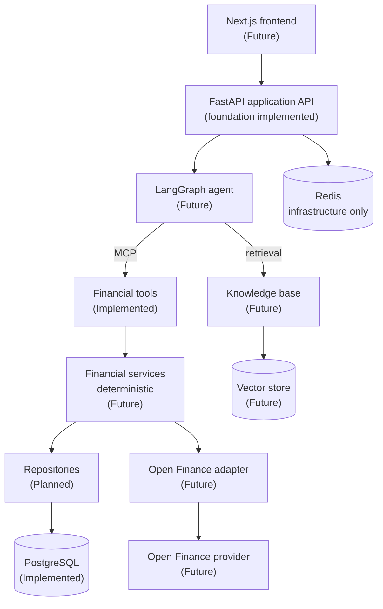

# Compass

An AI-powered personal financial assistant: it reads your financial history, works out
what you can actually afford, and explains the answer.

> **Project status: Phases 1-5 of 11 complete.** Financial data flows in from an Open
> Finance abstraction into PostgreSQL, and a deterministic engine turns it into cash
> flow, categorised spending, recurring commitments and a sustainable saving capacity -
> against a local sandbox fixture, not a real provider. Goals can be set and simulated
> against that measured capacity. The agent, the knowledge base and the frontend are
> **not implemented yet**. This README
> distinguishes throughout between what exists and what is planned - see the
> [roadmap](docs/roadmap.md).

---

## The problem

Most personal finance tools stop at a dashboard. They show you where the money went and
leave the actual question unanswered:

> *"I want R$20,000 for a trip in 18 months. Can I do it, and what should I do with the
> money in the meantime?"*

Answering that needs three different things, and generic chatbots conflate them:

1. **Your data** - what you actually earn and spend, not a budgeting template.
2. **Correct arithmetic** - sustainable saving capacity, goal feasibility, the gap. An
   LLM asked to do this produces confident, irreproducible, sometimes wrong numbers.
3. **Current product knowledge** - what a product's conditions are *today*, with a
   source, not what a model remembers about rates from its training data.

## The approach

Compass separates those three concerns and keeps them separate:

| Concern                 | Owner                                                  |
| ----------------------- | ------------------------------------------------------ |
| Financial data          | Open Finance adapter + PostgreSQL                      |
| Financial calculations  | Deterministic, unit-tested services exposed as MCP tools |
| Product knowledge       | RAG over curated sources, with provenance and dates    |
| Orchestration and wording | LLM agent (LangGraph)                                |

**The LLM never computes a number that matters.** It decides which tools to call and
explains the result. The engine calculates; retrieval supplies knowledge. That decision is
recorded in [ADR-0005](docs/adr/0005-deterministic-financial-engine.md) and it shapes
everything else.

## High-level architecture



Full detail, including the layering rules and the request flow for a goal simulation:
[docs/architecture.md](docs/architecture.md).

## Current status

**Implemented**

*Foundation (Phase 1)*

- FastAPI application with an application factory and lifespan-managed resources
- `GET /health` (liveness, no dependencies) and `GET /ready` (readiness, checks PostgreSQL)
- Generated OpenAPI docs at `/docs`, `/redoc`, `/openapi.json`, disabled in production
- Typed, environment-driven configuration; future credentials optional by design
- Structured single-line JSON logging
- Async SQLAlchemy 2.x + asyncpg, Alembic with an async environment
- Docker Compose stack: API + PostgreSQL + Redis
- ruff, mypy strict, pre-commit, Conventional Commits, GitHub Actions

*Financial domain (Phase 2)*

- `OpenFinanceProvider` protocol owned by Compass, with a sandbox implementation over a
  committed fixture: six months of realistic history, no network, no credentials
- `financial_institutions`, `accounts` and `transactions`, all scoped by `user_id`
- Idempotent ingestion keyed on the provider's own identifiers - re-syncing an
  overlapping window updates rows instead of duplicating them
- `POST /open-finance/sync`, `GET /accounts`, `GET /accounts/{id}`, `GET /transactions`
  (filterable by account and date window, paginated)
- Money as signed `NUMERIC(18, 2)`, serialised as JSON strings so no client rounds
  centavos into a float

*Financial engine (Phase 3)*

- Rule-based, deterministic expense categorisation, stored with the rule that produced it
  so any label can be traced to its cause
- Cash flow over a window: income, expenses, net, a monthly series marking partial
  months, and a category breakdown
- **Internal movements excluded** - a credit-card bill and a transfer to one's own
  savings are not spending, and counting them would overstate expenses by about 80% on
  the sandbox data (ADR-0009)
- Recurring-expense detection with an explicit definition of "recurring"
- Sustainable saving capacity: the median monthly net over whole calendar months, so one
  bonus month cannot become a monthly promise
- `GET /insights/cashflow`, `/insights/recurring-expenses`, `/insights/saving-capacity`

*Goals and simulation (Phase 4)*

- Goals store only their terms; every projection is computed on request, so a forecast is
  never stale (ADR-0010)
- Simulation, required contribution, gap against a deadline, path comparison, and
  progress against the straight line to the target date
- A forecast falls back from an explicit figure, to the goal's plan, to the **saving
  capacity measured from the user's own history** - and says which it used
- `POST /goals/simulate` answers "could I?" with nothing persisted
- Expected returns are always the caller's assumption - Compass does not yet know what
  any product pays, and will not invent a rate

*MCP tool layer (Phase 5)*

- Nine tools exposing the engine to an agent, thin over the same services the HTTP API
  uses, with contract tests asserting the two answer identically
- Schemas from type hints, descriptions from docstrings - a tool cannot drift from what
  it claims to do
- Runs standalone over stdio for any MCP client
- 255 tests (unit + integration), coverage reporting, eleven ADRs

**Planned next** - the agent layer: a LangGraph conversation that reaches the engine
through those tools, behind an LLM provider interface, with mocked model calls in the
tests. See [Phase 6](docs/roadmap.md#phase-6---agent-layer).

**Not implemented** - a real Open Finance provider, LangGraph agent, LLM calls, vector
store, RAG ingestion, Langfuse, Datadog, authentication, recommendations, frontend.

Redis runs in the local stack but **nothing consumes it yet**; it is infrastructure
prepared for caching, background jobs and rate limiting. No client library is installed,
because inventing a use case to justify a dependency is worse than an idle container.

## Technology stack

| Layer            | Choice                                      | Status                  |
| ---------------- | ------------------------------------------- | ----------------------- |
| Backend          | Python 3.13, FastAPI, Pydantic v2           | Implemented             |
| Database         | PostgreSQL 16, SQLAlchemy 2.x (async), Alembic | Implemented          |
| Financial data   | Own `OpenFinanceProvider` protocol; sandbox fixture adapter | Implemented (mock) |
| Packaging        | uv, `pyproject.toml`                        | Implemented             |
| Cache / queue    | Redis                                       | Infrastructure only     |
| Quality          | ruff, mypy (strict), pytest, pre-commit     | Implemented             |
| CI               | GitHub Actions                              | Implemented             |
| Local infra      | Docker Compose                              | Implemented             |
| Agent            | LangGraph, provider-agnostic LLM interface (OpenAI first) | Future    |
| Tooling protocol | MCP (`mcp` SDK, stdio server)               | Implemented             |
| Financial data (real) | A vendor adapter behind the same protocol | Future              |
| Knowledge base   | RAG, Pinecone intended (undecided)          | Future                  |
| Observability    | Langfuse (agent), Datadog (application)     | Future                  |
| Frontend         | Next.js, React, TypeScript                  | Future                  |

## Local development

Requires Docker with the Compose plugin, and [uv](https://docs.astral.sh/uv/) for
host-side work.

```bash
git clone <repository-url> && cd compass
cp .env.example .env
docker compose up --build
```

Then check it is up, create the demo user, and pull in the sandbox history:

```bash
curl localhost:8000/health   # {"status":"ok","version":"0.1.0"}
curl localhost:8000/ready    # {"status":"ready","checks":{"database":"ok"}}

make seed                    # -> 00000000-0000-4000-8000-000000000001
USER=00000000-0000-4000-8000-000000000001

curl -X POST -H "X-User-Id: $USER" localhost:8000/open-finance/sync
curl -H "X-User-Id: $USER" localhost:8000/accounts
curl -H "X-User-Id: $USER" 'localhost:8000/transactions?limit=5'

# Computed, never stored:
curl -H "X-User-Id: $USER" localhost:8000/insights/cashflow
curl -H "X-User-Id: $USER" localhost:8000/insights/recurring-expenses
curl -H "X-User-Id: $USER" localhost:8000/insights/saving-capacity

# "I want R$20,000 for a trip in 18 months" - answered against the measured capacity,
# with nothing created:
curl -X POST -H "X-User-Id: $USER" -H 'Content-Type: application/json' \
  -d '{"target_amount": "20000.00", "target_date": "2028-04-15"}' \
  localhost:8000/goals/simulate
```

`X-User-Id` is a temporary stand-in for authentication; every financial query is already
scoped by it. Running the sync twice is safe - ingestion is idempotent.

API documentation: <http://localhost:8000/docs> (Swagger UI) and
<http://localhost:8000/redoc>.

Running the API on the host against Dockerised infrastructure - the faster loop:

```bash
docker compose up -d postgres redis
make install        # dependencies + git hooks
make migrate        # alembic upgrade head
make run            # uvicorn --reload
```

`make help` lists every target. Full instructions, including environment variables and
troubleshooting: [docs/development.md](docs/development.md).

No secrets are committed. `.env` is git-ignored; `.env.example` documents every variable,
including the ones for capabilities that do not exist yet.

## Testing

```bash
make test        # full suite with coverage
make test-unit   # no infrastructure required
make check       # lint + types + tests (what CI runs)
```

231 tests. The engine's tests need no infrastructure at all - they are hand-written
movements with expected values worked out by hand, which is the only way to be confident
the arithmetic is right rather than merely stable. Unit tests construct settings
explicitly and need no infrastructure.
Integration tests are marked `integration` and need a reachable PostgreSQL with
migrations applied; they skip rather than fail without one. Each creates its own user and
deletes it afterwards, so they cannot see each other's data, and the sandbox provider is
pinned to a fixed reference date so date assertions are deterministic.

Coverage is a diagnostic, not a target - there is no threshold gate.

## Repository structure

```
compass/
├── apps/
│   ├── api/                      # FastAPI backend (implemented)
│   │   ├── src/compass_api/
│   │   │   ├── api/              # Routers, handlers, dependencies (transport only)
│   │   │   ├── core/             # Settings, structured logging
│   │   │   ├── db/               # Declarative base, session, models
│   │   │   ├── domain/           # Money rules, provider-neutral snapshots
│   │   │   ├── providers/        # Open Finance adapters + sandbox fixture
│   │   │   ├── repositories/     # All SQL lives here
│   │   │   ├── services/         # Ingestion, categorisation, the pure engine
│   │   │   ├── migrations/       # Alembic environment and revisions
│   │   │   ├── seed.py           # Local demo user
│   │   │   └── main.py           # Application factory
│   │   ├── tests/{unit,integration}
│   │   ├── Dockerfile
│   │   ├── alembic.ini
│   │   └── pyproject.toml / uv.lock
│   └── web/                      # Future Next.js app (README only)
├── docs/
│   ├── architecture.md
│   ├── development.md
│   ├── roadmap.md
│   └── adr/                      # Architecture decision records
├── infra/                        # Reserved for deployment assets
├── .github/workflows/ci.yml
├── docker-compose.yml
├── .env.example
├── Makefile
└── CONTRIBUTING.md
```

## Architecture decisions

| ADR | Decision |
| --- | -------- |
| [0001](docs/adr/0001-monorepo-with-independent-app-toolchains.md) | Monorepo with independent per-app toolchains |
| [0002](docs/adr/0002-fastapi-async-backend.md) | FastAPI and an async-first backend |
| [0003](docs/adr/0003-postgresql-sqlalchemy-alembic.md) | PostgreSQL + SQLAlchemy 2.x + Alembic |
| [0004](docs/adr/0004-thin-mcp-tools-over-a-service-layer.md) | Financial capabilities as thin MCP tools over services |
| [0005](docs/adr/0005-deterministic-financial-engine.md) | The deterministic engine computes, the LLM explains |
| [0006](docs/adr/0006-open-finance-provider-abstraction.md) | Open Finance data enters through a protocol Compass owns |
| [0007](docs/adr/0007-money-as-signed-decimals.md) | Money is a signed decimal, everywhere |
| [0008](docs/adr/0008-pure-financial-engine.md) | The financial engine is pure Python over fetched rows |
| [0009](docs/adr/0009-internal-movements-are-not-cash-flow.md) | Internal movements are excluded from income and expenses |
| [0010](docs/adr/0010-goals-store-terms-not-projections.md) | A goal stores its terms; every projection is computed |
| [0011](docs/adr/0011-mcp-tools-as-a-second-transport.md) | MCP is a second transport over the same services |

Vendor choices that are not yet decided - Open Finance provider, vector store,
observability integration - are tracked as open questions in the
[roadmap](docs/roadmap.md#open-questions) rather than written up as decisions.

## Roadmap

Eleven phases, from the foundation to the frontend:
[docs/roadmap.md](docs/roadmap.md). Each phase leaves the repository working and tested.

## Contributing

Conventional Commits, enforced locally and in CI. See [CONTRIBUTING.md](CONTRIBUTING.md).
