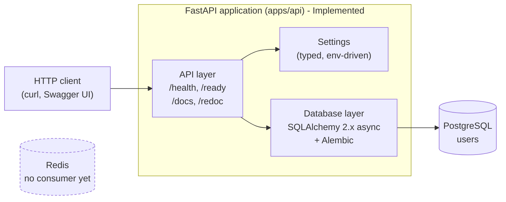
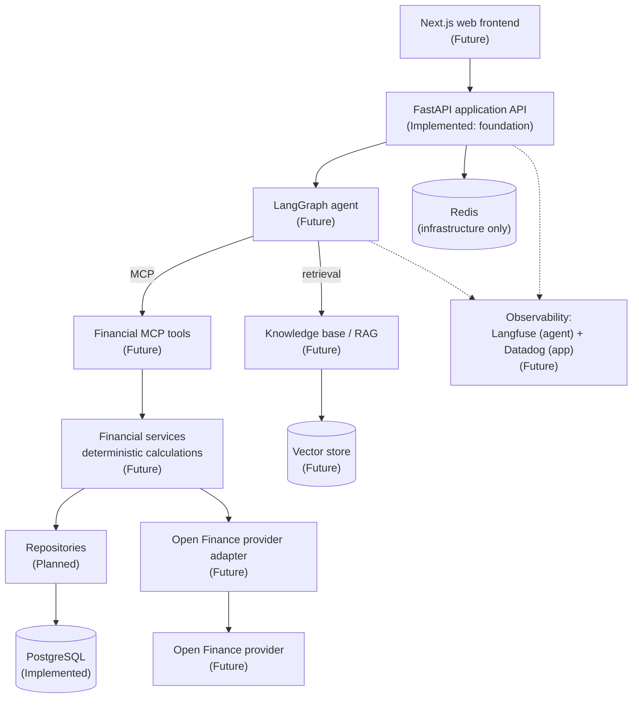
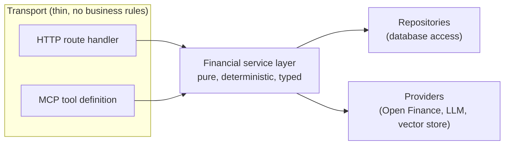
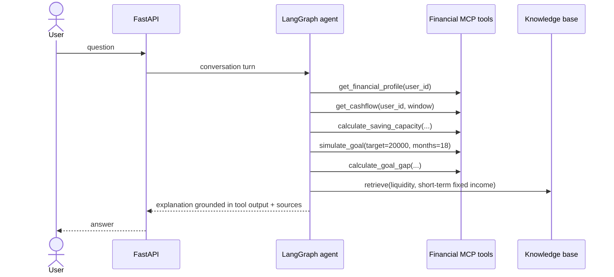
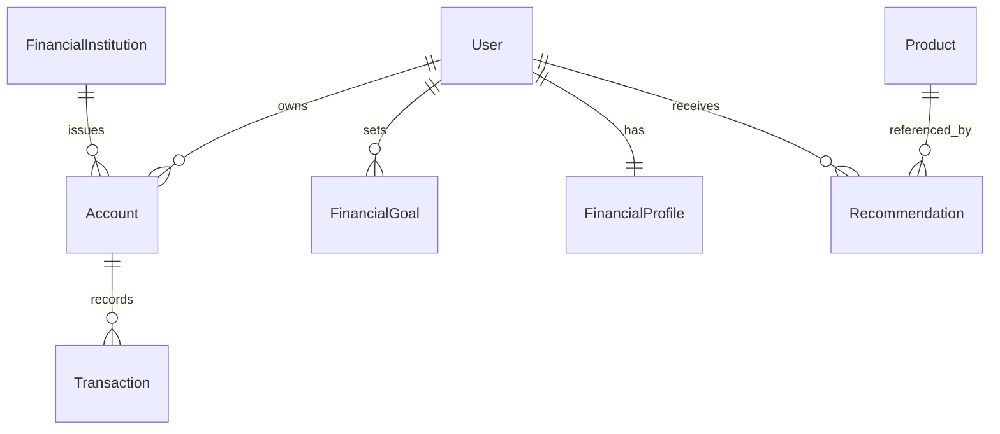

# Architecture

Status legend used throughout this document:

| Label           | Meaning                                                      |
| --------------- | ------------------------------------------------------------ |
| **Implemented** | Exists in the repository and is exercised by tests            |
| **Planned**     | Decided and scheduled on the roadmap, not built yet           |
| **Future**      | Directional. Needs an ADR before it becomes real              |

---

## 1. What exists today

Phase 1 delivered the backend foundation only: a FastAPI application, typed
configuration, an async database stack with migrations, and the local infrastructure to
run it.



Redis is part of the local stack but **nothing in the application connects to it**. It
is provisioned so that the first real need (caching, background jobs, rate limiting)
does not also require an infrastructure change. No client library is installed.

## 2. Target architecture



The arrows that matter: the frontend only ever talks to the application API, and the
agent reaches data only through tools. Nothing downstream of the API is a public
surface.

## 3. Layering rules

The system has one hard rule, and most of the architecture follows from it:

> Business logic lives in services. Everything else - HTTP handlers, MCP tool
> definitions, the agent - is transport.



Consequences:

- An MCP tool such as `simulate_goal` will be a schema plus a call into a service
  function. If a tool body grows a financial rule, that rule is in the wrong place.
- The same service can be exposed over HTTP, over MCP, or called from a test, without
  duplication.
- Protocol churn (MCP evolving, a new transport appearing) cannot reach the financial
  rules.

Repositories and services will be introduced when there is logic to hold. Phase 1
deliberately has neither: a repository wrapping a single `SELECT 1` would be ceremony,
not architecture.

## 4. Separation of responsibilities (the core design decision)

Financial advice fails in two distinct ways: wrong numbers, and wrong explanations. The
architecture keeps them apart so they can be tested and trusted separately. See
[ADR-0005](adr/0005-deterministic-financial-engine.md).

| Concern                   | Owner                        | Property required            |
| ------------------------- | ---------------------------- | ---------------------------- |
| User financial data       | Repositories / provider adapter | Auditable, isolated per user |
| Financial calculations    | Financial services (via MCP tools) | Deterministic, unit-tested |
| Product knowledge         | RAG over curated sources     | Sourced, dated, traceable    |
| Orchestration and wording | LLM agent                    | Helpful, grounded            |

**The LLM never computes a number that matters.** It decides which tools to call, in
what order, and explains the result in plain language.

Worked example - *"I want R$20,000 for a trip in 18 months"*:



Every number in the answer traces back to a tool call; every product statement traces
back to a retrieved document.

## 5. Data model direction

Implemented today: `users` only. It exists to validate the stack end to end and to
establish the ownership key.

Planned entities (**not** created yet, to avoid modelling a domain before the
calculations that use it exist):



**Data isolation.** Authentication does not exist yet, but every future financial table
carries a `user_id` foreign key, and every query path will be scoped by it. Designing
this in now means authentication later adds identity resolution, not a schema rewrite.

## 6. External integrations

### Open Finance (Future)

No provider has been chosen. Candidates include Pluggy and Belvo. The application will
depend on a protocol it owns, not on a vendor SDK:

```python
class OpenFinanceProvider(Protocol):
    async def get_accounts(self, user_id: UUID) -> Sequence[AccountSnapshot]: ...
    async def get_transactions(
        self, user_id: UUID, since: date, until: date
    ) -> Sequence[TransactionSnapshot]: ...
```

Development and tests will run against a mock/sandbox implementation of that protocol.
Sandbox and production credentials stay in separate environments, and real financial
credentials are never committed.

### LLM provider (Future)

The first implementation will target OpenAI. The agent will depend on a narrow internal
interface (chat completion, tool calling, embeddings) so that switching provider or
running a cheaper model for a subtask is a configuration change, not a rewrite.
`OPENAI_API_KEY` is already declared in settings as optional.

### Knowledge base / RAG (Future)

Pinecone is the current intention, not a decision - it has no ADR yet. The
non-negotiable part is **provenance and freshness**: financial product conditions go
stale, and a confidently outdated interest rate is worse than no answer.

Planned sources: Banco Central do Brasil, ANBIMA, Tesouro Direto, official bank product
documentation, financial education material.

Planned chunk metadata:

```
source | institution | product | category | retrieved_at | valid_from | url
```

Retrieval will filter and rank on freshness, and answers will cite the source and the
date, so a reader can tell whether a figure is current.

## 7. Observability (Future)

Two concerns, two tools, one rule: business logic must not import a vendor SDK.

- **Langfuse** - agent traces, prompts, tool calls, token usage, latency, cost.
- **Datadog** - API latency, error rates, logs, database and infrastructure metrics.

Preparation already in place: structured single-line JSON logs via
`compass_api.core.logging`, which any collector can ingest, and optional vendor keys in
settings that do not block startup when absent.

## 8. Operational endpoints

| Endpoint  | Question answered            | Touches the database |
| --------- | ---------------------------- | -------------------- |
| `/health` | Is the process alive?        | No                   |
| `/ready`  | Can this instance serve?     | Yes (`SELECT 1`)     |

Keeping them separate means a database blip degrades readiness (traffic is withheld)
without causing an orchestrator to restart otherwise healthy processes.

## 9. Security principles

Applied in Phase 1:

- No secrets in the repository; `.env` is git-ignored and `.env.example` is the contract.
- All configuration comes from the environment and is validated at startup.
- Credentials are typed as `SecretStr`, so they do not appear in logs, reprs or
  tracebacks (covered by a test).
- Connection errors are logged without echoing connection strings to clients.
- Interactive API docs are automatically disabled when `APP_ENV=production`.
- The container runs as a non-root user.

Committed to for later phases:

- Row-level scoping by `user_id` on every financial query.
- No raw financial data in logs - identifiers and aggregates only.
- Strict separation between sandbox and production Open Finance integrations.
