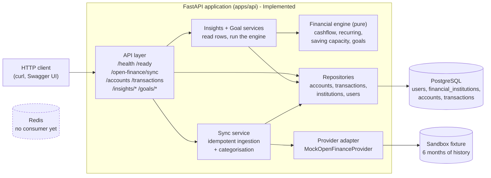
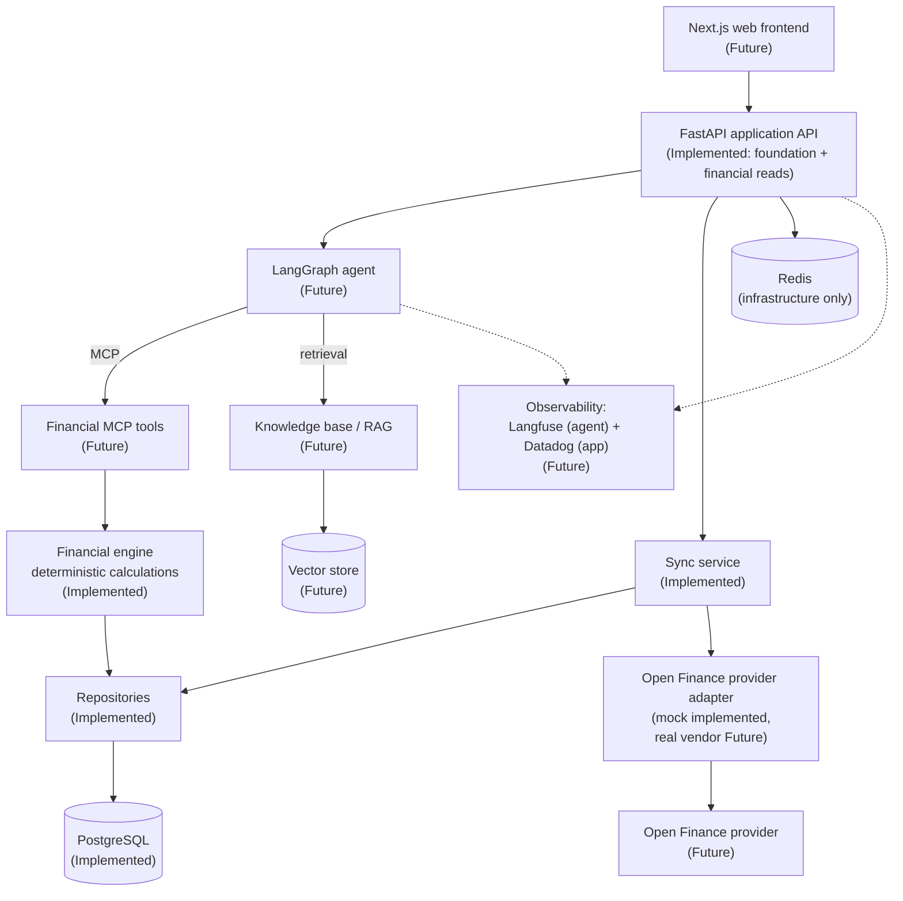
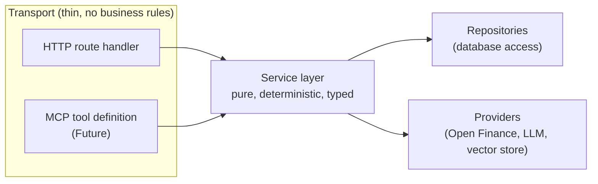
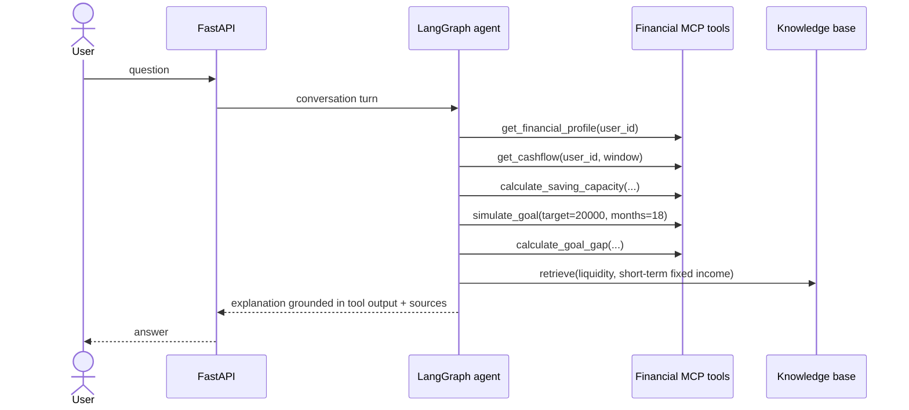
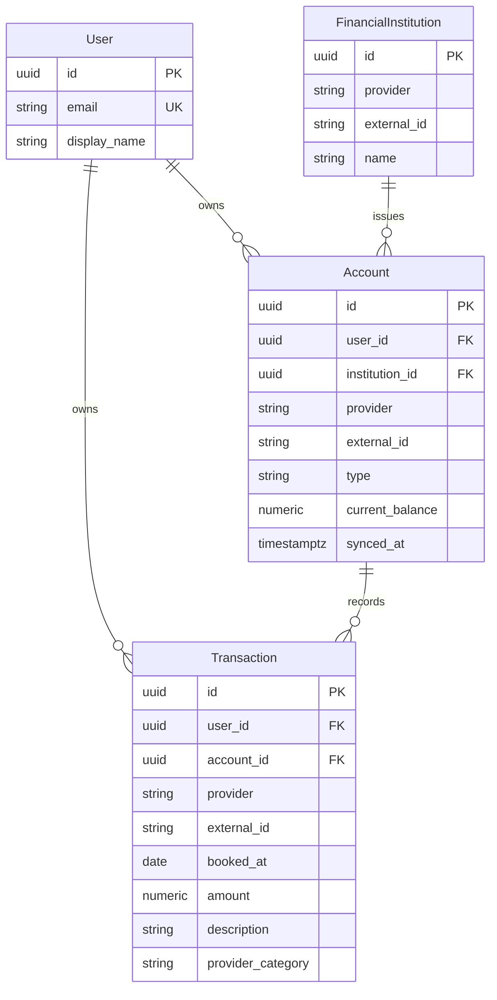
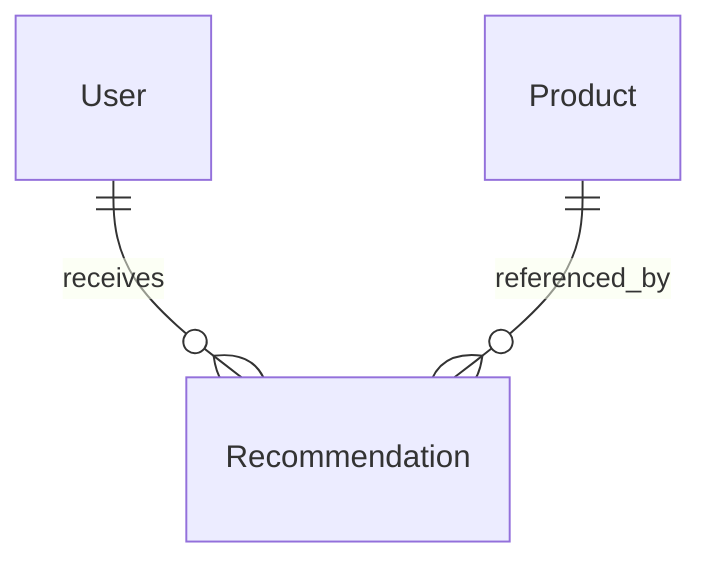

# Architecture

Status legend used throughout this document:

| Label           | Meaning                                                      |
| --------------- | ------------------------------------------------------------ |
| **Implemented** | Exists in the repository and is exercised by tests            |
| **Planned**     | Decided and scheduled on the roadmap, not built yet           |
| **Future**      | Directional. Needs an ADR before it becomes real              |

---

## 1. What exists today

Phase 1 built the backend foundation. Phase 2 added the financial domain: data arrives
from an Open Finance provider through an abstraction Compass owns, is stored
idempotently, and can be read back over HTTP. Phase 3 added the engine that turns it
into numbers - cash flow, categorised spending, recurring commitments, saving capacity -
all computed on request and never stored. Phase 4 added goals: the terms are stored, the
projections are not.



Redis is part of the local stack but **nothing in the application connects to it**. It is
provisioned so that the first real need - caching, or the background sync job that
replaces today's synchronous endpoint - does not also require an infrastructure change.
No client library is installed.

## 2. Target architecture



The arrows that matter: the frontend only ever talks to the application API, and the
agent reaches data only through tools. Nothing downstream of the API is a public surface.

## 3. Layering rules

The system has one hard rule, and most of the architecture follows from it:

> Business logic lives in services. Everything else - HTTP handlers, MCP tool
> definitions, the agent - is transport.



In the code today:

- `api/routes/open_finance.py` validates a window, calls `OpenFinanceSyncService`, maps
  the report to a response. It contains no rule about what a sync is.
- `services/open_finance_sync.py` is the only place that knows what syncing a user means.
- `services/cashflow.py`, `services/recurring.py`, `services/saving_capacity.py` and
  `services/goals_engine.py` are **pure**: no session, no repository, no settings, no I/O
  at all. They take values and return numbers (ADR-0008).
- `services/insights.py` and `services/goals.py` are the only places that join the two -
  they read rows through repositories and hand them to the engine. Routes orchestrate
  nothing.
- `repositories/` owns all SQL and contains no financial rules.
- An MCP tool for `get_cashflow` will be a schema plus a call into the same pure
  function. If a tool body grows a financial rule, that rule is in the wrong place
  (ADR-0004).

Repositories and services exist because there is now logic and SQL to hold. Phase 1
deliberately had neither: a repository wrapping a single `SELECT 1` would have been
ceremony, not architecture.

### Why the engine is pure

The engine's input type is `domain.analysis.Movement`, not the ORM `Transaction`. A
calculation therefore cannot reach a relationship, trigger a lazy load, or depend on the
schema - and its tests need no database, which is what makes it cheap to cover the edge
cases that matter: a partial month, an empty window, three charges of ten centavos.

## 4. Separation of responsibilities (the core design decision)

Financial advice fails in two distinct ways: wrong numbers, and wrong explanations. The
architecture keeps them apart so they can be tested and trusted separately. See
[ADR-0005](adr/0005-deterministic-financial-engine.md).

| Concern                   | Owner                        | Property required            |
| ------------------------- | ---------------------------- | ---------------------------- |
| User financial data       | Repositories / provider adapter | Auditable, isolated per user |
| Financial calculations    | Financial services (via MCP tools) | Deterministic, unit-tested |
| Product knowledge         | RAG over curated sources     | Sourced, dated, traceable    |
| Orchestration and wording | LLM agent                    | Helpful, grounded            |

**The LLM never computes a number that matters.** It decides which tools to call, in what
order, and explains the result in plain language.

Worked example - *"I want R$20,000 for a trip in 18 months"*:



Every number in the answer traces back to a tool call; every product statement traces
back to a retrieved document.

## 5. Data model

Implemented: `users`, `financial_institutions`, `accounts`, `transactions`.



Design points worth knowing:

- **`(user_id, provider, external_id)` on accounts and `(account_id, provider,
  external_id)` on transactions are unique.** They are the idempotency keys that make
  re-syncing an overlapping window safe (ADR-0006).
- **`user_id` is denormalised onto `transactions`.** It keeps the isolation filter on the
  same row as the data and spares every cash-flow query a join. The cost is one redundant
  column that ingestion must set correctly, which a test covers.
- **Amounts are `NUMERIC(18, 2)` and signed** - negative is an outflow. `direction` is
  derived, never stored (ADR-0007).
- **`account.type` is a VARCHAR with a CHECK constraint**, not a native PostgreSQL enum:
  adding a value later is an ordinary migration rather than an `ALTER TYPE` that cannot
  run inside a transaction.
- **`provider_category` keeps the provider's own label, and `category` holds Compass's
  own.** They are separate columns on purpose: the provider's label stays auditable, and
  `category_rule` records which rule produced ours, so a surprising categorisation can be
  traced to its cause. The category is assigned at ingestion and refreshed by every
  sync, which is how a change to the rules reaches rows already stored.

Planned next, when the calculations that use them exist:



`financial_goals` was added in Phase 4 and stores only terms - target amount, optional
target date, what was already set aside, the planned contribution, status. No projection
is stored, so none can go stale ([ADR-0010](adr/0010-goals-store-terms-not-projections.md)).

`FinancialProfile` is deliberately absent. A table of self-declared attributes with no
consumer would be premature; what the agent will need - saving capacity, recurring
commitments, cash-flow shape - is already computed from real data. It belongs with the
suitability rules, where something will finally read it.

**Data isolation.** Authentication does not exist yet, but every financial table carries
`user_id`, every repository method takes it, and every query filters on it. An account id
that belongs to someone else reads as `404`, not `403` - existence is itself information.
When authentication arrives it supplies the same value from a verified token; nothing
downstream changes.

## 6. External integrations

### Open Finance (mock implemented, vendor undecided)

No provider has been chosen. Candidates include Pluggy and Belvo. The application depends
on a protocol it owns - `OpenFinanceProvider` - and on the frozen snapshots in
`compass_api.domain.open_finance`. A vendor field that is not in a snapshot does not
enter the system. See [ADR-0006](adr/0006-open-finance-provider-abstraction.md).

```python
@runtime_checkable
class OpenFinanceProvider(Protocol):
    @property
    def name(self) -> str: ...
    async def get_institutions(self, user_id: UUID) -> Sequence[InstitutionSnapshot]: ...
    async def get_accounts(self, user_id: UUID) -> Sequence[AccountSnapshot]: ...
    async def get_transactions(
        self, user_id: UUID, since: date, until: date
    ) -> Sequence[TransactionSnapshot]: ...
```

`MockOpenFinanceProvider` implements it over a committed fixture: six months of realistic
history for three accounts at two institutions, no network, no credentials. Fixture dates
are a month offset plus a day resolved against a reference date, so the data stays recent
without being rewritten and a test that pins the date gets identical results.

Choosing a real provider means writing one adapter and changing
`compass_api.api.deps.get_open_finance_provider`. Sandbox and production credentials will
live in separate environments; real financial credentials are never committed.

### LLM provider (Future)

The first implementation will target OpenAI. The agent will depend on a narrow internal
interface (chat completion, tool calling, embeddings) so that switching provider or
running a cheaper model for a subtask is a configuration change, not a rewrite.
`OPENAI_API_KEY` is already declared in settings as optional.

### Knowledge base / RAG (Future)

Pinecone is the current intention, not a decision - it has no ADR yet. The non-negotiable
part is **provenance and freshness**: financial product conditions go stale, and a
confidently outdated interest rate is worse than no answer.

Planned sources: Banco Central do Brasil, ANBIMA, Tesouro Direto, official bank product
documentation, financial education material.

Planned chunk metadata:

```
source | institution | product | category | retrieved_at | valid_from | url
```

Retrieval will filter and rank on freshness, and answers will cite the source and the
date, so a reader can tell whether a figure is current.

## 7. Observability (Future)

Two concerns, two tools, one rule: business logic must not import a vendor SDK.

- **Langfuse** - agent traces, prompts, tool calls, token usage, latency, cost.
- **Datadog** - API latency, error rates, logs, database and infrastructure metrics.

Preparation already in place: structured single-line JSON logs via
`compass_api.core.logging`, which any collector can ingest, and optional vendor keys in
settings that do not block startup when absent. The sync service already logs counts and
identifiers only - never amounts, descriptions or merchants.

## 8. HTTP surface

| Endpoint                   | Purpose                                  | Requires `X-User-Id` |
| -------------------------- | ---------------------------------------- | -------------------- |
| `GET /health`              | Liveness. Touches no dependency          | No                   |
| `GET /ready`               | Readiness. Checks PostgreSQL             | No                   |
| `POST /open-finance/sync`  | Ingest accounts and transactions         | Yes                  |
| `GET /accounts`            | List the user's accounts                 | Yes                  |
| `GET /accounts/{id}`       | One account, scoped to its owner         | Yes                  |
| `GET /transactions`        | Paginated, filterable by account and window | Yes               |
| `GET /insights/cashflow`   | Income, expenses, net, monthly series, categories | Yes            |
| `GET /insights/recurring-expenses` | Monthly recurring charges        | Yes                  |
| `GET /insights/saving-capacity` | Sustainable monthly saving            | Yes                  |
| `POST /goals`              | Create a goal                            | Yes                  |
| `GET /goals`, `GET /goals/{id}` | The user's goals                    | Yes                  |
| `PATCH /goals/{id}`        | Update terms or record progress          | Yes                  |
| `GET /goals/{id}/forecast` | Simulation, gap and progress, computed now | Yes                |
| `POST /goals/{id}/comparison` | Compare contribution and return scenarios | Yes             |
| `POST /goals/simulate`     | "Could I?" - nothing persisted           | Yes                  |

Keeping liveness and readiness separate means a database blip withholds traffic without
causing an orchestrator to restart otherwise healthy processes. Probes require no user: an
orchestrator has no identity to present.

`X-User-Id` is a temporary stand-in for authentication. It is trusted, which is why
authentication comes before any deployment on the roadmap. The value it carries is already
the isolation key used by every query, so replacing its source with a verified token
changes nothing downstream.

`POST /open-finance/sync` is synchronous because the sandbox provider answers instantly.
Against a real provider it becomes a queued job returning `202` and a job id - the first
concrete use for the Redis already in the stack.

Everything under `/insights` is **computed on request and never stored**. That is why
those paths do not look like resources: there is no cash-flow row anywhere, only
transactions and a pure function over them.

### Where a forecast's numbers come from

A goal forecast assumes a monthly contribution, and says where that figure came from:
the caller's own request, the goal's plan, or the saving capacity measured from the
user's history. The same answer means something different depending on which - so the
API reports it rather than leaving the reader to guess.

The expected return is always the caller's assumption, defaulting to zero. Compass does
not know what any product pays; the knowledge base that could say so, with a source and a
date, is a later phase. Inventing a rate here would put an unsourced number inside every
projection, which is exactly what ADR-0005 exists to prevent.

### What counts as income and expense

A credit-card bill payment and a transfer to one's own savings are **internal**: they
move money the user already has. They are excluded from income and expenses, because the
card's spending is already counted where it happened. On the sandbox history, counting
them would overstate expenses by about 80%. The excluded total is reported alongside the
figures rather than dropped silently. See
[ADR-0009](adr/0009-internal-movements-are-not-cash-flow.md).

## 9. Security principles

Applied so far:

- No secrets in the repository; `.env` is git-ignored and `.env.example` is the contract.
- All configuration comes from the environment and is validated at startup.
- Credentials are typed as `SecretStr`, so they do not appear in logs, reprs or
  tracebacks (covered by a test). A blank value reads as absent, never as configured.
- Every financial query is scoped by `user_id`; another user's row reads as `404`.
- The sync service logs counts and identifiers, never financial data.
- Connection errors are logged without echoing connection strings to clients.
- Interactive API docs are automatically disabled when `APP_ENV=production`.
- The container runs as a non-root user.
- No real financial credentials exist: the only provider is a local fixture.

Committed to for later phases:

- Authentication, after which `user_id` comes from a verified token.
- Authorisation tests proving cross-user reads are impossible.
- Strict separation between sandbox and production Open Finance integrations.
